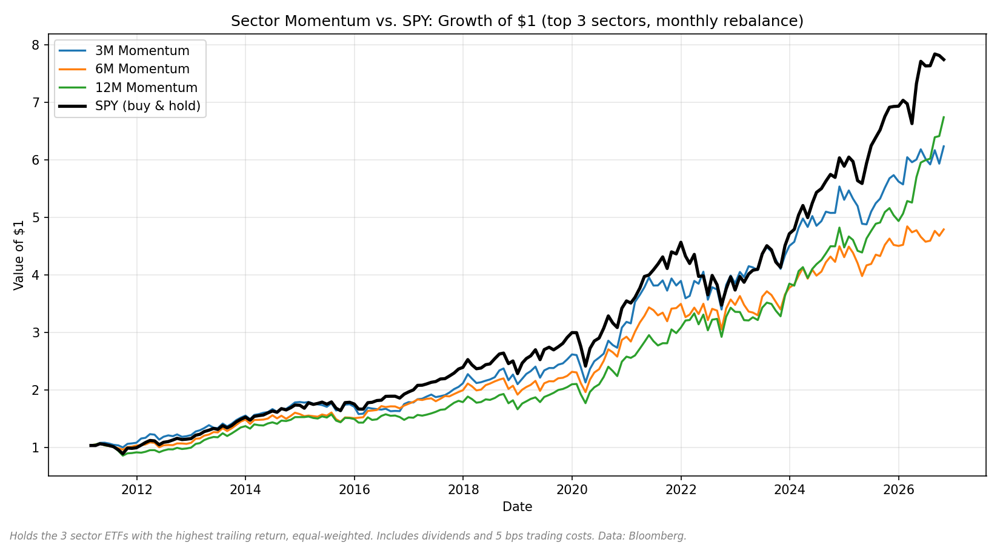
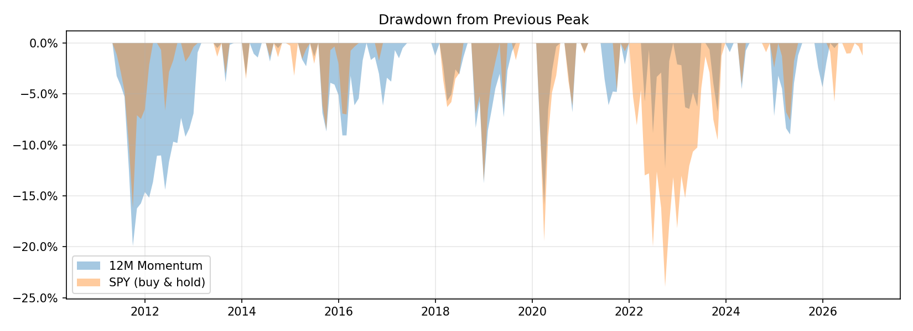

# Sector Momentum Backtest

A backtest of a simple sector rotation strategy: each month, hold the three U.S. sector ETFs with the highest trailing return, equal-weighted, and compare the result against buying and holding SPY.

**Result:** over February 2011 – October 2026 (189 months), the 12-month version matched SPY on a risk-adjusted basis (Sharpe 0.98 vs. 1.00) with a shallower maximum drawdown (−19.9% vs. −23.9%), but trailed on return (12.9% vs. 13.9% a year). Most of its relative gains came in two years, 2022 and 2026.

📄 **[Read the full research note (PDF)](Sector_Momentum_Research_Note.pdf)**



## Strategy

- **Universe:** 9 Select Sector SPDR ETFs: XLK, XLF, XLE, XLV, XLI, XLY, XLP, XLU, XLB
- **Signal:** trailing total return over 12 months (3 and 6 months also tested)
- **Portfolio:** top 3 sectors, one-third weight each, rebalanced monthly
- **Benchmark:** SPY buy and hold
- **Costs:** 5 bps per dollar traded
- **No lookahead:** weights chosen at the end of month *t* earn month *t+1* returns

## Results

| Metric | 12M Momentum | 6M | 3M | SPY |
|---|---:|---:|---:|---:|
| Annualized return (CAGR) | 12.9% | 10.5% | 12.3% | 13.9% |
| Annualized volatility | 13.4% | 13.2% | 14.3% | 14.0% |
| Sharpe ratio (rf = 0) | 0.98 | 0.82 | 0.89 | 1.00 |
| Maximum drawdown | −19.9% | −15.2% | −18.6% | −23.9% |
| Beta to SPY | 0.81 | 0.78 | 0.83 | 1.00 |
| Months outperforming SPY | 53.4% | 46.0% | 51.9% | – |
| Growth of $1 | $6.74 | $4.79 | $6.23 | $7.74 |



### Key takeaways

1. **No return advantage.** Simple sector momentum did not beat passive exposure over this period.
2. **Lower risk, similar Sharpe.** The strategy's beta of 0.81 accounts for most of the return gap.
3. **Bear-market protection, from one episode.** In 2022 the strategy returned +8.9% while SPY lost 18.2%. That benefit rests on a single bear market.
4. **Unstable across lookbacks.** The 6-month version did noticeably worse than the 3- and 12-month versions, a warning against picking the best parameter after the fact.

## How to run

```bash
pip install pandas numpy matplotlib
python sector_momentum.py
```

Settings such as `TOP_N`, `LOOKBACKS_TO_TEST` and `COST_BPS` are at the top of the script. Charts and tables are saved to `output/`.

## Data

Monthly total return index levels with dividends reinvested (`TOT_RETURN_INDEX_GROSS_DVDS`), pulled from a Bloomberg Terminal with the Excel add-in:

```
=BDH("XLK US Equity","TOT_RETURN_INDEX_GROSS_DVDS","1/1/2010","","Per=M")
```

**The raw data is not included** because Bloomberg's license does not allow redistribution. To reproduce the results, pull the same fields for SPY and the nine sector ETFs into a CSV with a `Date` column, and set `DATA_FILE` in the script.

## Limitations and next steps

- One sample period, dominated by a long bull market; no significance testing
- Planned extensions: an absolute momentum filter (hold cash when a sector's trend is negative), alpha regression with t-statistics, and history extended back to 1998 to include the 2000–2002 and 2008 bear markets

See the [research note](Sector_Momentum_Research_Note.pdf) for full methodology and discussion.

---

*Educational project. Not investment advice. Results are hypothetical backtests and do not represent actual trading.*
